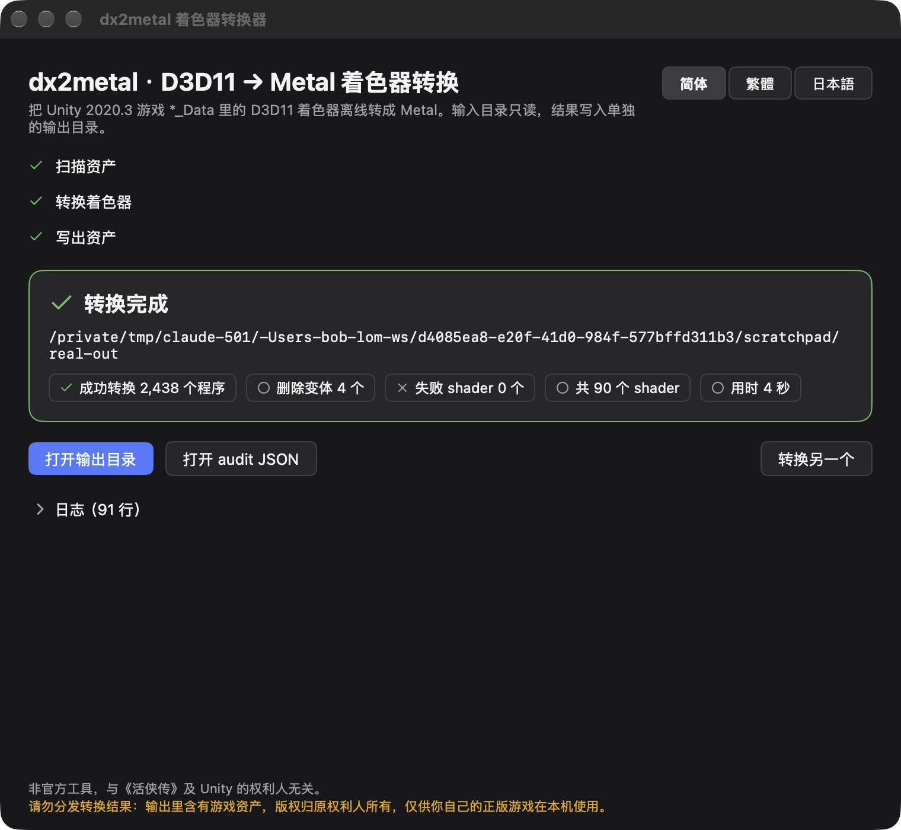

# lom-dx2metal

这个工具可以把 Unity 2020.3 Windows 版游戏里的 D3D11 着色器离线转换成 Metal，让 Unity 官方的 macOS Apple Silicon Player 直接跑起 Windows 版的游戏数据。
最初是为《活侠传》做的，不过对其他只带 D3D11 着色器的 Unity 2020.3.x 游戏同样适用。



这是玩家自制的非官方工具，和《活侠传》的开发商、Unity 都没有关系。转出来的包里带有游戏本体的文件，这些文件既不是我们的也不是你的，只能留在你自己的电脑上自己玩。千万别打包发给别人、传网盘或上传到任何地方；如果朋友想玩，请让他自己买游戏、自己动手转。

仓库里只包含转换器源码，不附带任何游戏文件，也没有 Unity Player、Steam 或 Wwise 的库。想了解把游戏整体跑起来还需要准备哪些东西、具体怎么验证，可以查阅 [docs/ARTICLE.md](docs/ARTICLE.md)，或者参考那份可以直接贴给编码 agent 的 [docs/AGENT-BRIEF.md](docs/AGENT-BRIEF.md)。

## 图形界面

用法很简单，把游戏的 `*_Data` 文件夹拖进窗口，点击"开始转换"，几秒钟后旁边就会多出一个 `*_Data.metal` 目录，里面装的就是改好的资产文件。
界面支持简体中文、繁體中文、日本語三语，转换进度、失败列表、打开输出目录和查看 audit 的功能都在界面里。详细说明见 [gui/README.md](gui/README.md)。

如果你想自己动手构建（需要 Apple Silicon Mac、Xcode 命令行工具 `xcode-select --install`、Go 1.26 以上版本，工具链会自动按 go.mod 升到 1.27.1）：

```bash
cd gui && ./build.sh        # 生成 gui/build/dx2metal GUI.app（arm64，ad-hoc 签名）
```

第一次打开时，需要先在"系统设置 → 隐私与安全性"里放行一次。

## 命令行

底层是同一个引擎的命令行外壳，适合写脚本调用或交给编码 agent 使用。

```bash
go build -o bin/dx2metal ./cmd/dx2metal      # 首次构建要编译 HLSLcc，约半分钟

# 转换整个 Data 目录（只读），把改过的资产文件写到输出目录（保持相对路径），并写 audit
bin/dx2metal convert --in "<游戏>/Mortal_Data" --out out/Data

# 只转某几个 shader；指定 audit 路径；给前端用的 JSON 进度
bin/dx2metal convert --in "<游戏>/Mortal_Data" --out out/Data --only "Hidden/Universal Render Pipeline/UberPost" --audit out/audit.json --progress-json

# 查看一个资产文件里的 Shader、各平台程序数与 Metal 程序的 tail 摘要
bin/dx2metal inspect out/Data/globalgamemanagers.assets

# 检查每个 Metal 程序的 legacy tail 能否逐字节往返
bin/dx2metal verify out/Data/globalgamemanagers.assets
```

- `--in` 目录永远只读；`--out` 必须指定，工具不做原地改写。输出目录里只会生成**改过的**资产文件（与 `--in` 下的相对路径相同）和 `dx2metal-audit.json`，转完后把它们覆盖到游戏 Data 的副本里即可。
- 默认会扫描 `Resources/unity_builtin_extra`、`*.assets`、`level*`、`StreamingAssets/**/*.bundle`，并且只处理仅带 D3D11 程序的 Shader。处理后的 bundle 会以 LZ4 重新打包。
- 退出码说明：0 代表成功；2 代表输入错误；3 代表有 shader 完全没能转换（其余已正常输出，具体在 audit 中列明）；1 代表其他错误。
- 在《活侠传》上的转换结果：共 102 个 shader / 2550 个程序 → 成功转换 2546 个，耗时约 8 秒。剩下的 4 个是给 VR/XR 用的程序，游戏本身不用。

## 代码结构

```
gui/            拖放界面（egoist/mygo，原生 macOS），主要交付物
core/           引擎：公开 Go API，core.Run(ctx, Options, onEvent)
internal/       SerializedFile 读写、shader blob 与 legacy tail、DXBC/RDEF 合成、HLSLcc（cgo）、Metal 反射（cgo）、常量缓冲区重排
cmd/dx2metal/   命令行外壳
third_party/    HLSLcc 源码（MIT，含一处 null-guard 补丁），cgo 静态编进二进制
arm64-mods/     BepInEx 在 Apple Silicon 上的补丁（LGPL，附源码），文章与任务书引用
docs/           文章、agent 任务书、验收记录
```

无论是 GUI 还是 CLI，底层都只直接调用 `core` 包，不依赖 Python，也不会在后台起子进程：

```go
res, err := core.Run(ctx, core.Options{In: in, Out: out}, func(e core.Event) { /* 进度 */ })
```

可以直接在 goroutine 里运行，`ctx` 取消即中止；即便单个程序转换失败，也只会记入 audit，不会拖垮整个进程。

## 测试与验收

```bash
go test ./...
```

需要依赖 oracle 数据（即旧 Python 版的产出和原版游戏文件）的测试，在本地数据不存在时会自动跳过。关于六条验收标准（tail 与 SerializedFile 逐字节往返、MSL 与 blob 与 Python 版逐字节一致、程序数量核对、实机运行）的具体命令与结果，详见 [docs/ACCEPTANCE.md](docs/ACCEPTANCE.md)。

## 三条根因

这个工具之所以存在，正是为了解决下面这几个关键问题，相关细节在代码里都有注释：

1. 常量与纹理的反射信息放在程序 blob 末尾的 legacy tail 里，而不在 ParsedForm 中。如果 tail 写错，进游戏就会黑屏（`internal/shaderblob`、`core/tail.go`）。
2. 同名的常量缓冲区必须跨 common/variant 参数表按成员合并，否则对应成员会变成永远是 0 的 pad，导致画面里的角色贴图发暗（`internal/params.Merge`）。
3. 内联采样器必须以 `sampler_LinearClamp` 这类名字写进 RDEF，并保留为 constexpr sampler；否则 LUT 会退化为用 point 采样，导致 Story 场景出现色带（`internal/params.InlineSamplerName`）。

## 许可

本项目采用 MIT 许可开源。用到的第三方组件各自遵循其原有许可，详见 `third_party/HLSLcc/license.txt` 和 `arm64-mods/README.md`。
